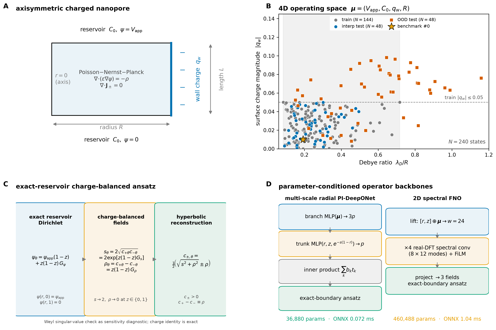
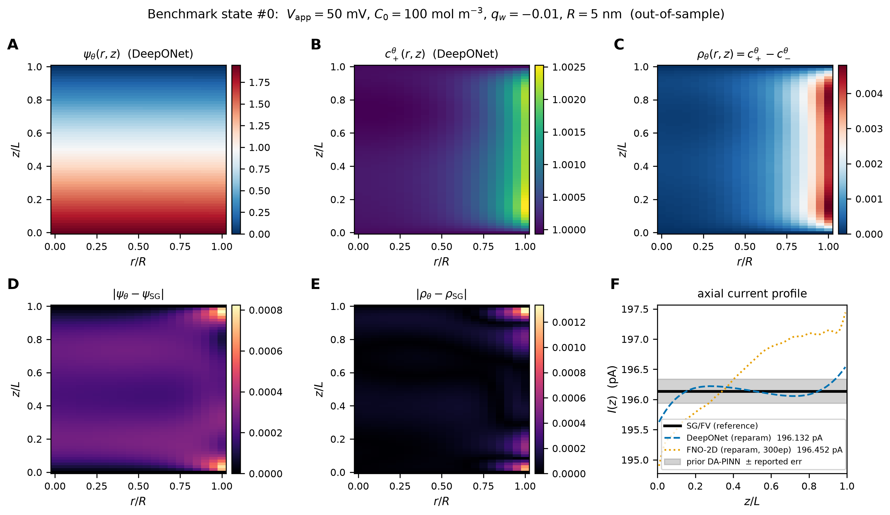
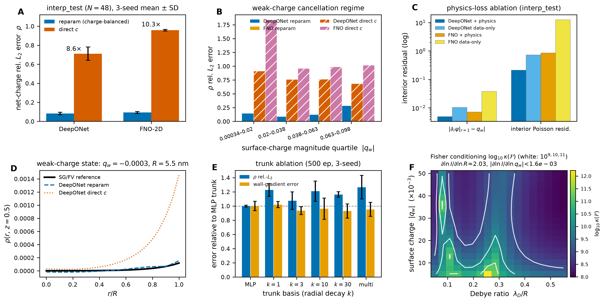
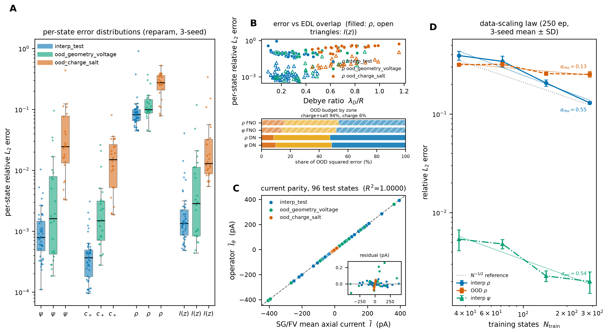
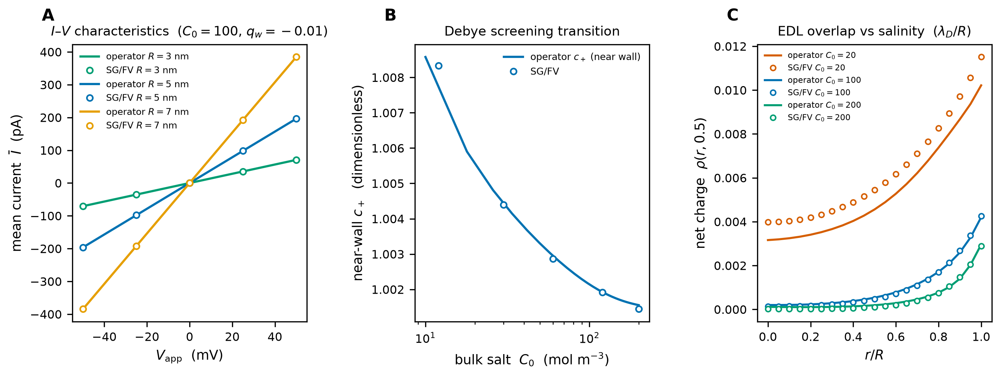
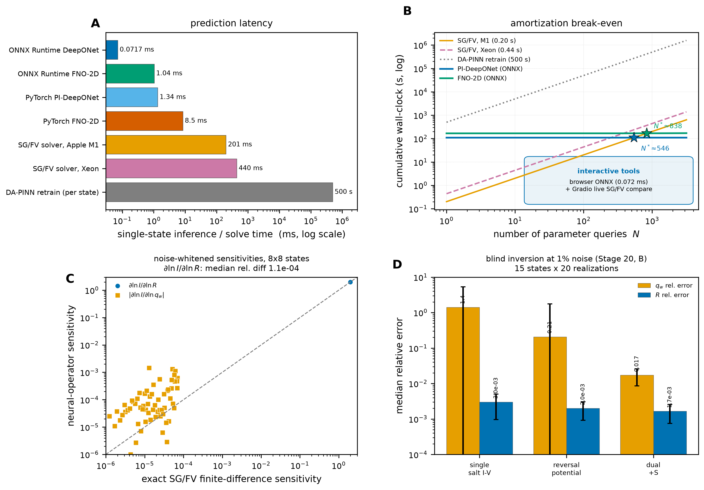

# Sensitivity-controlled physics-constrained neural operators and conductance identifiability limits for Poisson--Nernst--Planck transport in charged nanopores

**Javad Alizargar**  
Department of Nursing, National Taipei University of Nursing and Health Sciences, No. 365, Mingde Rd, Beitou District, Taipei City 112, Taiwan  
Corresponding author: 8javad@ntunhs.edu.tw | ORCID: 0000-0003-2966-1315

---

## Highlights

- PINO-Nanopore maps four PNP parameters in 0.072 ms with 13% lower net-charge error.
- Exact SG/FV Jacobians validate $\partial\ln I/\partial\ln R\approx2$ to $10^{-4}$.
- Negative-$q_w$ Fisher is ill-conditioned (median $\kappa\approx1.2\times10^9$).
- Blind dual inversion: 1.7\% charge error, 68\% 95\% coverage at 1\% noise.
- Warm-started hybrid solver: $3\times10^{-12}$ current error at 9.5-fold lower cost.

---

## Abstract

Inferring nanopore surface charge and geometry from ionic current--voltage data is central to nanofluidic sensing, but repeated Poisson--Nernst--Planck (PNP) solves are too slow for exhaustive identifiability mapping. We present PINO-Nanopore, an exact-boundary, charge-balanced operator for axisymmetric PNP transport over voltage, salinity, wall charge, and radius, used to map regime-dependent conductance identifiability. A 240-state SG/FV benchmark has maximum residual $9.936\times10^{-10}$. A multi-scale radial physics-informed DeepONet (36,880 parameters) and a real-DFT Fourier neural operator (460,488 parameters) enforce reservoir data and charge identity to $1.1\times10^{-16}$. The DeepONet reaches relative $L_2$ errors of 0.00089 for potential and 0.00109 for current (0.0202/0.00136 out of distribution) at 0.072 ms per state. Against a matched direct-concentration loss, charge-balanced outputs lower median net-charge error from 0.238 to 0.207 with 18% lower current error; linearized-Poisson--Boltzmann, POD-RBF, and FNO baselines are reported. Exact float64 SG/FV Jacobians reproduce $\partial\ln I/\partial\ln R\approx2$ to $10^{-4}$. A negative-$q_w$ Fisher plane is ill-conditioned (median $\kappa(\mathcal{F})=1.2\times10^{9}$; 99.1% above $10^{8}$), with 1%-noise CRLBs of 0.37% for radius but 86 for charge. Single- and multi-salt inversion leave charge unidentifiable. A 2,700-realization blind inverse study gives a dual current-plus-selectivity median charge error of 1.7\% but only 68\% 95\% coverage at 1\% noise; the reversal potential is state dependent (263\% weak-charge, 7.3\% strong-charge), and a reference-free warm-started controller reproduces the SG/FV current to $3\times10^{-12}$ at 0.165 s, 9.5-fold below a cold solve. A strong-charge benchmark lowers current error 23-fold.

**Keywords:** Poisson--Nernst--Planck; nanopore; neural operator; DeepONet; Fourier neural operator; physics-informed machine learning; inverse problem; identifiability; Donnan selectivity

---

## CPC Program Summary

**Program title:** PINO-Nanopore

**CPC Library link to program files:** To be added by the CPC Technical Editor

**Developer's repository link:** https://github.com/Javad-Alizargar/nanopore-pino-surrogate (permanent archive: https://doi.org/10.5281/zenodo.23487404; interactive portal: https://pino.statwhy.com/)

**Code Ocean capsule:** Not applicable (standalone browser ONNX and Python package included)

**Licensing provisions:** MIT License (MIT)

**Programming language:** Python 3.10+ (tested on 3.14); JavaScript ES6

**Supplementary material:** Supplementary Materials PDF/DOCX (Supplementary Sections S0--S10 and Supplementary Tables S1--S22)

**Nature of the problem:** Steady, axisymmetric Poisson--Nernst--Planck transport of a symmetric binary electrolyte in a charged cylindrical nanopore. The solver must represent the potential, both ion concentrations, the net charge density, and the axial current over a four-dimensional operating space: applied voltage, bulk concentration, wall charge strength, and pore radius. Repeated high-fidelity finite-volume solves are accurate but cost about 0.2 s each, which is prohibitive for design sweeps, uncertainty quantification, and inverse parameter estimation. A second problem is scientific rather than computational: it is not known which of these parameters a conductance measurement can actually identify, because geometric access and wall-charge Donnan enrichment enter the current in a correlated way.

**Solution method:** A conservative Scharfetter--Gummel finite-volume reference solver generates a verified 240-state dataset. Two parameter-conditioned operator backbones are trained: a multi-scale radial physics-informed DeepONet and a parameter-conditioned two-dimensional Fourier neural operator. Both use an exact-reservoir Dirichlet ansatz and a charge-balanced field parameterization that guarantees positive concentrations and an exact algebraic charge identity. The operator is then used as a computational instrument: its Fisher information is validated against exact float64 finite-difference Jacobians of the reference solver, and the resulting identifiability map separates radius from wall charge and identifies the near-wall Donnan selectivity observable that breaks the conductance degeneracy. Models are exported to ONNX and served by a static browser simulator (JavaScript) with a live reference solve and a Gradio application.

**Additional comments including restrictions and unusual features:** The model is two-dimensional and axisymmetric; it neglects steric effects, electro-osmotic convection, surface chemistry, and pore-wall roughness. Temperature, permittivity, and ionic diffusivities are fixed. The operator is trained on in-distribution ranges of $-50$ to 50 mV, 20--200 mol $m^{-3}$, $-0.05 \le q_w \le 0$, and 3--8 nm radius; extrapolation beyond these ranges is not certified. The package includes a dual-engine browser simulator that can switch between the operator and an in-browser SG/FV solve. It was developed on an Apple M1 (arm64) with macOS 14.1, 8 GB RAM, and one CPU core (no GPU required); the dependencies support Linux, Windows, and x86-64 or arm64 systems with Python 3.10+ and a modern browser. The repository README documents installation, file layout, and execution, and the `test_run/` directory provides a self-contained sample input and expected output for a rapid CPC verification run.

**Running time:** Dataset generation 59.2 s; DeepONet training 50.6 s for 500 epochs; FNO training 108.5 s for 110 epochs; single-state inference 0.072 ms (DeepONet) and 1.04 ms (FNO) on an Apple M1 CPU. The Stage-10 studies add 29.6 s to generate the 144-state expansion, 50 s per 500-epoch trunk-ablation model, and 25 s per 250-epoch scaling model. The Stage-11 constraint benchmark (five schemes, three seeds), exact SG/FV Jacobian validation, and Stage-12 diagnostics add about five minutes; the Stage-18 inverse, baseline, and strong-charge studies add about 35 minutes on one CPU. The CPC test case in `scripts/run_cpc_test_case.py` completes in under one second on one CPU.

---

## 1. Introduction

Estimating the surface charge and geometry of a nanopore from its ionic conductance is a central inverse problem in nanofluidic sensing, yet the measurement is fast while the physics that connects it to the parameters is slow to evaluate and ambiguous to invert. Nanopores and nanofluidic channels convert molecular-scale charge and geometry into measurable ionic currents, underpinning single-molecule sensing and nucleic-acid sequencing prospects [1--6]. In confined nanoscale geometries, ion transport departs from bulk conductance due to surface-charge-governed transport at low salt concentrations [7], electrostatic screening when the Debye length approaches the channel dimension [8], interfacial electrokinetic coupling [9], ion-transport mechanisms specific to nanofluidic channels [10], and structure-dependent transport mechanisms [11].

Across nanofluidic devices, ionic transport, selectivity, and current rectification are modulated by applied gate or axial potentials [12], salt concentration and surface charge [13], conical pore geometry and electrostatic potential jumps [14], surface-charge patterning [15], and coupled effects of pore diameter, surface-charge density, and ionic strength [16], while the Poisson--Nernst--Planck (PNP) system provides a widely used continuum framework for modeling and numerically solving ion-channel and nanopore transport [17--19].

In narrow channels, electrokinetic flow with overlapped electrical double layers [20], double-layer-enhanced ion migration and water dissociation [21], surface charge regulation [22], and electroosmotic solute dispersion [23] further modify nanoscale transport, while related ion-transport and ion-mobility physics underlie fluidic iontronic computing devices [24] and electrolyte conductivity in charged nanochannels [25].

Relating current--voltage behavior to surface charge and channel geometry is therefore a central modeling problem in nanofluidics [7, 8]. In charged channels, the measured conductance reflects geometric confinement and surface-charge-governed ion accumulation [13], with electrostatic screening becoming important at low salt concentration [22], while rectification in conical or charge-patterned pores depends jointly on pore-end asymmetry [14] and surface-charge distribution [15]. Separating the two from conductance alone remains an open experimental and theoretical challenge, and the usual remedy---fitting many curves with repeated PNP solves---is slow and statistically opaque. Three concrete uses follow for a fast, validated operator: pre-experiment protocol design, in which bias and salinity combinations are chosen to maximize the Fisher information for the parameters of interest; rapid design sweeps of radius, charge, and operating point; and real-time digital-twin calibration, in which millisecond operator evaluations are compared continuously with a measured current. Each use requires not only speed but a calibrated statement of what the measurement can resolve.

Numerical solution of PNP is well understood. Scharfetter--Gummel (SG) discretizations were introduced for semiconductor carrier transport [26]. Conservative finite-volume formulations, including the Scharfetter--Gummel box method [27], provide a stable discretization framework for drift--diffusion device equations. A single axisymmetric solve on a 21 x 61 grid takes about 0.2 s on a modern laptop, which is acceptable for one operating point but not for the thousands of evaluations demanded by parameter sweeps, sensitivity analysis, design optimization, or inverse estimation. The cost is compounded when a neural surrogate is trained per state.

Physics-informed neural networks (PINNs) [28--30] and neural trial-function formulations [31] embed differential equation constraints into the training loss to reduce reliance on labeled solution data, but standard PINNs are typically trained for one parameter set at a time and are sensitive to gradient-flow pathologies and optimization failure modes [32, 33]. Hard-constraint and boundary-enforcing formulations impose initial or boundary conditions strictly across benchmark PDE problems [34], wave equations [35], airflow-field reconstruction [36], linear free-surface waves [37], nonlinear consolidation [38], variational Dirichlet benchmarks [39], and microseismic source imaging [40], while domain-decomposed variants such as XPINNs enable space--time decomposition on complex geometries [41]. Enriched physics-informed neural networks have been developed for dynamic Poisson--Nernst--Planck systems [42], while related physics-informed and operator-learning surrogates have been applied to thermal charring materials [43], compressible flows with CF-DeepONet [44], non-Fourier heat conduction with T-phPINN [45], and lithium-ion battery health prediction [46]. A previously reported fixed-state discontinuous-Galerkin DA-PINN for nanopore transport (COMPHY-D-26-00857) reached a potential relative L2 error of $3.82\times10^{-4}$ but required roughly 500 s of retraining per state. That trade-off motivates the present work: if the parameter dependence can be learned once, the per-query cost falls by orders of magnitude.

Operator learning provides the required map from parameters to fields. DeepONet approximates nonlinear operators through a branch--trunk inner product [47], supported by infinite-dimensional approximation error estimates [48], physics-informed DeepONet formulations for parametric PDEs [49], backpropagation-free and layer-interaction training variants [50, 51], theoretical universality analyses for operator learning [52], and architectural comparisons of DeepONet variants [53]. In parallel, Fourier neural operators (FNOs) have been extended to general geometries via XFNO [54] and Gabor-filtered spectral layers [55], as well as decomposed large-scale parametric PDEs with D-FNO [56] and physics-informed Fourier neural operator formulations [57, 58]. Neural Green's operators provide an additional route to parametric PDE solution by learning Green's functions [59], while spatio-spectral neural operators combine spatial and spectral feature learning [60]. The central difficulty for transport in charged pores is not representational capacity but constraint satisfaction: potentials must satisfy reservoir Dirichlet data, concentrations must remain positive, and the predicted charge must equal the difference of the predicted concentrations. Unconstrained outputs violate these requirements, and the resulting errors are largest precisely where the net charge is small.

This paper makes two contributions. First, we deliver PINO-Nanopore, a validated computational-physics software instrument: a verified 240-state four-dimensional benchmark (maximum residual $9.936\times10^{-10}$; minimum anion concentration 0.8034), an exact-reservoir charge-balanced parameterization (charge identity $1.110\times10^{-16}$), two parameter-conditioned backbones (multi-scale radial PI-DeepONet, 36,880 parameters; real-DFT FNO, 460,488 parameters) trained with three seeds each, and a browser and Gradio deployment with 0.072 ms ONNX inference. A five-way benchmark, including a direct-concentration model retrained with a matched field loss, shows that charge-balanced outputs lower median net-charge error from 0.238 to 0.207 while keeping current error 18\% lower; the linear projection is statistically tied on net charge but leaves a finite charge-identity mismatch, whereas the hyperbolic map guarantees $c_\pm>0$ and an exact algebraic identity without a Softplus bias. The physics weight is set at its Pareto value $10^{-3}$. A trunk ablation and a nested 384-state study bound the design: the radial basis lowers the wall-gradient error by about 7\% without a bulk-accuracy advantage, in-distribution error scales as $N^{-0.55}$, and out-of-distribution error is nearly data-insensitive (exponent 0.13). Second, we use the operator to resolve the identifiability question that motivated it. Its conductance sensitivities agree with exact float64 SG/FV finite-difference Jacobians to $1.1\times10^{-4}$ in $\partial\ln I/\partial\ln R$; a negative-$q_w$ Fisher plane is ill-conditioned (median $\kappa(\mathcal{F})=1.2\times10^{9}$; $99.1\%$ above $10^{8}$), with 1\%-noise CRLBs of 0.37\% for radius but 86 for charge. Single- and multi-salt current--voltage protocols leave charge unidentifiable at 1\% noise, whereas a blind Stage-20 dual current-plus-selectivity protocol reaches 1.7\% median charge error and 0.17\% radius error, but with only 68\% 95\% coverage at 1\% noise because a roughly 2\% surrogate bias floor remains. A strong-charge benchmark lowers current error 23-fold relative to the Ohmic bulk approximation, without claiming that single-salt conductance alone identifies charge. Finally, a spatial and parametric decomposition of the out-of-distribution error shows that the residual error is largest per unit reference in the wall EDL and at the reservoir transitions, yet it cancels in the cross-sectionally integrated current, which stays below 0.23\%.

The remainder of the paper describes the model and reference solver (Section 2), reports accuracy, ablation, timing, deployment, and inversion results (Section 3), and discusses scope and limitations (Section 4). This manuscript is submitted as a Computer Programs in Physics (CPiP) contribution: PINO-Nanopore is designed not merely as a fast forward surrogate, but as a reusable protocol-design instrument that enables experimentalists to determine which measurements can identify which nanopore parameters before an experiment is built.

---

## 2. Methods

### 2.1 Physical model and dimensionless form

We consider a rigid, straight cylindrical pore of radius $R$ and length $L=30$ nm connecting two reservoirs at temperature $T=298.15$ K. The pore is filled with a symmetric binary electrolyte of bulk concentration $C_0$; the cation and anion diffusivities are $D_+=1.96\times10^{-9}$ $m^2$ $s^{-1}$ and $D_-=2.03\times10^{-9}$ $m^2$ $s^{-1}$. The relative permittivity is $\varepsilon_r=78.5$. A uniform surface charge of strength $q_w$ is imposed on the wall, and an axial voltage $V_\mathrm{app}$ is applied between the reservoirs. The unknowns are the electrostatic potential $\psi$, the cation and anion concentrations $c_\pm$, and the net charge density $\rho=c_+-c_-$.

The steady PNP system, comprising the Poisson equation and the continuity statement in Eq. (1) and the Nernst--Planck fluxes in Eq. (2), is

$$
-\nabla\cdot\left(\varepsilon_r\varepsilon_0\nabla\psi\right)=F\left(c_+-c_-\right),
\qquad
\nabla\cdot\mathbf{J}_\pm=0,
$$

$$
\mathbf{J}_\pm=-D_\pm\left(\nabla c_\pm\pm\frac{F}{RT}c_\pm\nabla\psi\right),
$$

where $F$ is Faraday's constant and $R$ the gas constant. At the reservoir faces, $\psi=V_\mathrm{app}$ and $\psi=0$, and $c_\pm=C_0$. On the charged wall, $\varepsilon_r\varepsilon_0\,\partial_r\psi|_\mathrm{wall}=\sigma$ and $\mathbf{J}_\pm\cdot\mathbf{n}=0$; on the axis, symmetry conditions apply. The wall charge strength is $q_w=\sigma R/(\varepsilon_r\varepsilon_0 V_T)$, with $V_T=RT/F$; this sign convention makes a negative $q_w$ produce the negative wall potential and cation enrichment seen in the reference solver.

We non-dimensionalize lengths by $R$ radially and by $L$ axially, concentrations by $C_0$, and potential by $V_T$. The Poisson coupling becomes $\beta=(L/\lambda_D)^2/2$, with $\lambda_D=\sqrt{\varepsilon_r\varepsilon_0 R_gT/(2F^2 C_0)}=\sqrt{\varepsilon_r\varepsilon_0 V_T/(2F C_0)}$, and the geometric anisotropy is $\alpha_r=(L/R)^2$. The operating point, Eq. (3), is the four-vector

$$
\boldsymbol{\mu}=\left(V_\mathrm{app},\,C_0,\,q_w,\,R\right).
$$

The in-distribution training box is $-50 \le V_\mathrm{app} \le 50$ mV, $20 \le C_0 \le 200$ mol $m^{-3}$, $-0.05 \le q_w \le 0$, and $3 \le R \le 8$ nm. The full dimensionless system, including the SG face fluxes used in the physics loss, is written out in Supplementary Section S3. The generated dataset also contains deliberate out-of-distribution charge/salt and geometry/voltage states, as described below.

### 2.2 Conservative SG/FV reference solver and dataset

The reference solver adapts the node-centered finite-volume Scharfetter--Gummel box discretization developed and analyzed for stationary semiconductor drift--diffusion equations [26, 27] to axisymmetric Nernst--Planck currents with a conservative Poisson update. The production grid is $21\times61$ (radial $\times$ axial). Each state is first attempted directly; if the Newton/Gummel iteration does not converge, a deterministic continuation ramps $q_w$ at zero voltage and then ramps the voltage at the target charge, carrying the potential forward as the initial guess. A state is accepted only if the residual is below $10^{-9}$, all fields are finite, and both concentrations are strictly positive. The face flux uses the Bernoulli function $B(x)=x/(e^x-1)$: $J_{z,i+1/2}=-\left(c_{i+1}B(-\Delta\psi_i)-c_iB(\Delta\psi_i)\right)/\Delta z$, with the radial expression analogous; the Poisson update uses the conservative five-point stencil. The discrete equations are repeated in Supplementary Section S3.

The dataset contains $N=240$ states: 144 training states sampled by Latin hypercube inside the in-distribution box with boundary and corner anchors, 48 interpolation-test states, and 48 out-of-distribution states (24 with charge/salt outside the training box, 24 with geometry/voltage outside the box). The exact split composition, sampled ranges, and per-split counts are listed in Supplementary Table S1. Dataset construction took 59.18 s in total. The maximum residual over all states is $9.936\times10^{-10}$, the minimum cation concentration is 0.9999, and the minimum anion concentration is 0.8034; the full validation summary is tabulated in Supplementary Table S2. No state required continuation. The median SG/FV wall time is 0.2013 s and the mean is 0.2391 s.

The benchmark state (index 144, interpolation split) is $V_\mathrm{app}=50$ mV, $C_0=100$ mol $m^{-3}$, $q_w=-0.01$, and $R=5$ nm. Its reference mean axial current is 196.1 pA. This state is used for the field and current comparisons in Section 3.2.

### 2.3 Exact-reservoir and charge-balanced parameterization

The operator does not output $c_+$ and $c_-$ directly. It predicts three smooth latent fields $G_\psi$, $G_s$, and $G_\rho$ on the fixed grid, where $0 \le z \le 1$ is the normalized axial coordinate. The potential, Eq. (4), is

$$
\psi_\theta(r,z)=V_\mathrm{app}(1-z)+z(1-z)\,G_\psi(r,z),
$$

so that $\psi_\theta(r,0)=V_\mathrm{app}$ and $\psi_\theta(r,1)=0$ hold exactly for any $G_\psi$. The concentration sum and net charge, Eq. (5), are

$$
s_\theta(r,z)=2\exp\!\left(z(1-z)\,G_s(r,z)\right),\qquad
\rho_\theta(r,z)=z(1-z)\,G_\rho(r,z),
$$

with the exponent clipped to the interval from $-15$ to $15$ for numerical safety. At both reservoirs the envelope $z(1-z)$ vanishes, so $s_\theta\to2$ (i.e., $2C_0$ in dimensional units) and $\rho_\theta\to0$, which gives $c_{\pm,\theta}\to1$ (i.e., $C_0$) exactly. Physical concentrations are recovered from the hyperbolic identity, Eq. (6),

$$
c_{\pm,\theta}=\frac{1}{2}\left(\sqrt{s_\theta^2+\rho_\theta^2}\pm\rho_\theta\right).
$$

Because $\sqrt{s^2+\rho^2}\ge|\rho|$, both concentrations are non-negative for any real $s$ and $\rho$, and the algebraic identities $c_{+,\theta}-c_{-,\theta}=\rho_\theta$ and $c_{+,\theta}+c_{-,\theta}=\sqrt{s_\theta^2+\rho_\theta^2}=\Sigma c_\theta>0$ hold exactly. Thus $s_\theta=2\sqrt{c_{+,\theta}c_{-,\theta}}>0$ is the positive geometric salt scale, while the capital $S$ denotes the near-wall selectivity observable. In the implementation the residual of the charge identity is $1.110\times10^{-16}$, i.e., machine precision. The same parameterization is applied to both backbones, so architecture comparisons are not confounded by different constraint handling.

This structural construction should be distinguished from soft penalty-based boundary enforcement in physics-informed neural networks, which has been compared with hard or exact boundary imposition across benchmark PDEs [34, 39], wave propagation [35, 37], airflow reconstruction [36], nonlinear consolidation [38], and microseismic imaging [40]. No boundary or positivity penalty is required; the constraints are structural. The physics loss is used only to penalize violations of the differential equations in the interior.

### 2.4 Operator backbones

**Multi-scale radial PI-DeepONet.** The branch network maps the four parameters to $3p$ latent coefficients. The trunk network maps the coordinates and four fixed radial boundary-layer features, $(r,z,\{e^{-\kappa(1-r)}\}_{\kappa\in\{1,3,10,30\}})$, to $p$ basis functions; the multi-scale exponential features resolve the thin EDL near $r=1$ without increasing the trunk width. The two latent vectors are combined by an inner product, and the resulting three fields are passed through the exact-boundary and charge-balanced reconstruction. The model has $p=64$ and 36,880 trainable parameters. The radial basis is a design choice rather than a requirement: Section 3.3 and Supplementary Table S3 compare it against a plain MLP trunk and single-scale radial variants at matched capacity and training budget, using the configuration key `use_radial_basis`/`radial_scales` in `scripts/operators/deeponet.py`.

**Parameter-conditioned two-dimensional FNO.** The FNO lifts the coordinate pair and the four parameters to a width of 24 channels, applies four spectral convolution blocks with $8\times12$ modes and FiLM parameter conditioning, and projects to three fields. The spectral convolutions use a real discrete Fourier transform so that the exported graph contains no complex-valued operators. The model has 460,488 trainable parameters.

Both backbones are trained with the same data and physics objective. The data term is a per-state normalized mean-squared error on the three latent fields, with the scale of each state floored at 10% of the global RMS. The physics term is the sum of the mean absolute Poisson residual, the mean absolute continuity residual for each ion, and the mean absolute wall potential and zero-flux residuals (Supplementary Section S2). The total loss, Eq. (7), is

$$
\mathcal{L}=\mathcal{L}_\mathrm{data}+10^{-3}\,\mathcal{L}_\mathrm{phys}.
$$

The complete procedure---data generation, constraint construction, joint training, and evaluation---is summarized as Algorithm 1 in Supplementary Section S2, together with pinned dependency versions and wall-clock budgets.

### 2.5 Training, splits, and metrics

Models are trained with seeds 42, 43, and 44. The DeepONet is trained for 500 epochs and the FNO for 110 epochs, with batch size 36, learning rate $2\times10^{-3}$, FNO width 24, FNO modes $8\times12$, and DeepONet inner dimension 64. Training times for seed 42 are 50.59 s (DeepONet) and 108.5 s (FNO). A separate 300-epoch FNO is trained to test whether the 110-epoch budget is the limiting factor. The complete optimizer, schedule, architecture, and seed settings are tabulated in Supplementary Table S4.

Accuracy is reported as the global relative $L_2$ error, Eq. (8),

$$
\epsilon_\mathrm{rel}=\frac{\lVert f_\theta-f_\mathrm{ref}\rVert_2}{\lVert f_\mathrm{ref}\rVert_2}
$$

for $\psi$, $c_+$, $c_-$, $\rho$, and the axial current $I(z)$, together with the mean absolute current error in pA. The current is computed from the predicted fields with the same Scharfetter--Gummel face-flux formula used by the reference solver, so current errors include both field errors and post-processing consistency. All reported means are averages over the three seeds, and spreads are reported as standard deviations in Supplementary Table S5 and in the per-state error distributions presented in Section 3.4. Extended accuracy metrics and residual diagnostics are collected in Supplementary Table S6. A cross-reference index (Supplementary Table S7) maps every figure, table, and archived artifact to its source file. The manuscript reports 3--4 significant figures in the narrative and in the supplementary tables; full machine-precision values are archived in `results/statistics.json` and `results/tables/*.csv`.

### 2.6 Deployment and inverse recovery

The trained DeepONet and FNO are exported to ONNX. Parity is checked against PyTorch on 96 states; the maximum absolute difference is $3.576\times10^{-7}$. The DeepONet is served (i) in a static browser simulator with a JavaScript evaluator and an optional in-browser SG/FV solve and (ii) in a Gradio application with operator-versus-reference comparison. Supplementary Table S8 lists the deployment and parity checks, including the browser-bundle size, the JavaScript-versus-reference agreement, and the DOM test results.

To separate a measurement limitation from a surrogate limitation, the inverse study is a controlled identifiability experiment over 15 held-out interpolation states selected to span the Debye-overlap range. Current--voltage observations are generated with the exact SG/FV solver at $V_\mathrm{app}=-50,-25,0,25,50$ mV. Protocol 1 (single-salt) uses the state's own bulk concentration; Protocol 2 (multi-salt) uses three concentrations spanning 10--100 mol $m^{-3}$; Protocol 3 (dual) adds the near-wall Donnan selectivity $S=(c_+-c_-)/(c_++c_-)|_{r=1}$ to the multi-salt data. For each protocol, 20 independent noise realizations at 0.2\%, 1\%, and 2\% relative noise are inverted on a $61\times61$ candidate grid in $(q_w,R)$, followed by quadratic refinement. The complete study is repeated on a $121\times121$ grid to test discretization nesting. We report medians and interquartile ranges over the 600 protocol--noise--state samples, with 95\% coverage and the fractions satisfying the 10\% charge and 2\% radius criteria.

The Fisher analysis uses a $18\times18$ grid over $-0.05\le q_w<0$ and $20\le C_0\le200$ mol $m^{-3}$ at $R=5$ nm. For each point we form $J=\partial\ln|I|/\partial\ln(R,|q_w|)$ from four non-zero biases, whiten by the 1\% relative noise, and evaluate $\kappa(\mathcal{F})$ and the Cramér--Rao lower bounds (CRLBs) of $\mathcal{F}=J^\top J/\sigma^2$. The $V_\mathrm{app}=0$ point is excluded because it carries no current information. An independent $8\times8$ exact SG/FV check compares the same sensitivities and the single-salt Fisher scale with the operator; a five-state SG/FV-in-the-loop refinement tests the inverse ranking under the exact forward model. Results are reported in Section 3.9 and Supplementary Table S9, and visualized in Figures 3F and 6C,D.

---

## 3. Results

### 3.1 Reference dataset and solver validation

All 240 states converged directly, with a maximum residual of $9.936\times10^{-10}$ and strictly positive concentrations (Supplementary Table S2). The smallest anion concentration, 0.8034, occurs in the strongest-overlap states, where the EDL occupies a large fraction of the pore cross-section. The benchmark current is 196.1 pA, and the SG/FV median and mean wall times are 0.2013 s and 0.2391 s. These values define the cost baseline for the amortization analysis in Section 3.7.

Figure 1 summarizes the problem. Panel A shows the axisymmetric geometry, reservoirs, wall charge, and the PNP equations. Panel B places all 240 states in the $(\lambda_D/R,|q_w|)$ plane, colored by split, with the benchmark state marked; the in-distribution band and the training charge limit are indicated. Panel C shows the exact-reservoir and charge-balanced construction. Panel D compares the two backbones, including parameter counts and ONNX latencies.

**Figure 1.** Problem definition and architecture. (A) Axisymmetric charged nanopore of radius $R$ and length $L$, with fixed wall charge $q_w$, reservoirs at $z=0$ and $z=1$, and applied bias $V_\mathrm{app}$. (B) The 240-state operating space in the four parameters $(V_\mathrm{app},C_0,q_w,R)$, showing the 144 training states, 48 interpolation-test states, and 48 out-of-distribution states. (C) Structural constraints of the exact-reservoir formulation: the ansatz imposes reservoir potential and concentration values, zero wall ion flux, the wall charge condition, and positive concentrations, while the charge-balanced map enforces the charge identity algebraically. (D) The two parameter-conditioned backbones: a DeepONet with a multi-scale radial trunk and a 2D Fourier neural operator, both trained with the same data and physics objective.

### 3.2 Field reconstruction and selectivity observable validation

Figure 2 resolves the held-out benchmark state (index 144) panel by panel. The operator reconstructs the potential $\psi_\theta$ (Figure 2A) and cation concentration $c_+^\theta$ (Figure 2B) smoothly and symmetrically about the axis, with the potential dropping along the pore and the cation layer accumulating against the negatively charged wall. The net charge $\rho_\theta$ (Figure 2C) is depleted in the core and enriched in the wall layer. The absolute errors in potential and net charge (Figure 2D,E) remain localized to the reservoir transitions and the wall layer rather than accumulating in the interior, and the axial current profile (Figure 2F) follows the reference to within the line width over most of the pore. For reference, a state-specialized DA-PINN reaches 0.000382 potential and 0.00102 current relative $L_2$ error on this state after roughly 500 s of single-state retraining (Supplementary Table S10); on this unseen state the operator's errors (0.0001485 and 0.0005587) are 2.57-fold and 1.83-fold lower without per-state retraining.

The same fields carry the observable used for identifiability. At the 15 inversion operating points and three salt concentrations, the operator reproduces the exact SG/FV near-wall Donnan selectivity $S=(c_+-c_-)/(c_++c_-)|_{r=1}$ with a median absolute error of $1.2\times10^{-4}$ (1.9% relative, rising only where $|S|\to0$), the wall concentrations $c_{\pm,\theta}|_{r=1}$ to 0.02--0.03% (1.1% worst case), and the full $c_\pm$ fields to better than 0.2% relative $L_2$; the log-sensitivity $\partial S/\partial\ln|q_w|$ agrees to 3%. These numbers validate the concentration field used for protocol design, not only the current.

**Figure 2.** Benchmark state (index 144, a held-out interpolation-test state; $V_\mathrm{app}=50$ mV, $C_0=100$ mol $m^{-3}$, $q_w=-0.01$, $R=5$ nm). (A) DeepONet potential $\psi_\theta(r,z)$. (B) DeepONet cation concentration $c_+^\theta(r,z)$. (C) DeepONet net charge $\rho_\theta=c_+^\theta-c_-^\theta$. (D) Absolute potential error against the SG/FV reference. (E) Absolute net-charge error. (F) Axial current profile $I(z)$ for the SG/FV reference, the DeepONet, the FNO, and the prior fixed-state DA-PINN (band shows its reported error). All fields are normalized by their reference scales and plotted on the physical grid.

### 3.3 In-distribution accuracy and the value of charge reparameterization

Averaged over three seeds and 48 interpolation states, the DeepONet attains relative $L_2$ errors of 0.0008914 for $\psi$, 0.0007275 for $c_+$, 0.08248 for $\rho$, and 0.001093 for $I$ (mean absolute current error 0.08031 pA). The FNO attains 0.005495, 0.001641, 0.0931, and 0.008511 (0.6746 pA), so the DeepONet is 6.16-fold, 2.26-fold, 1.13-fold and 7.79-fold more accurate, respectively.

The net-charge metric is the most sensitive to the output parameterization. Naive direct concentration outputs give interp-test $\rho$ errors of 0.7116 (DeepONet) and 0.9578 (FNO); the charge-balanced parameterization reduces them to 0.08248 and 0.0931, i.e. 8.63-fold and 10.29-fold. That large contrast, however, partly reflects an optimization pathology of the naive direct loss. When the direct model is retrained with the same field-normalized loss used for the other schemes, its three-seed net-charge error falls to $0.238\pm0.057$, versus $0.207\pm0.015$ for the hyperbolic map, and its current error is $0.00514$ versus $0.00417$; the matched direct model is therefore 15\% worse on net charge and 23\% worse on current. The four original schemes plus this matched control form the five-way benchmark in Figure 3A,B and Supplementary Table S11. The linear projection is statistically tied with the hyperbolic map on net charge ($0.201\pm0.021$), the soft penalty is worse ($0.411\pm0.187$), and the naive direct model is worst ($0.933\pm0.008$). The hyperbolic map is preferred not because it is more accurate than the linear projection, but because it guarantees $c_\pm>0$ and an exact algebraic charge identity without a projection bias. The linear projection leaves a charge-identity mismatch of $4.2\times10^{-8}$ and its raw reconstruction can become negative when co-ion exclusion is strong (22\% of a physical latent grid would be clipped), with a Softplus bias $O(\beta^{-1}\ln2)=0.035$ near $c_-\to0$; the hyperbolic map is parameter-free, exact to machine precision ($1.1\times10^{-16}$) and guarantees $c_+c_-=(s/2)^2>0$ at the same accuracy. Figure 3C,D examines the physics-loss and physics-weight ablations (Supplementary Table S12); $\lambda_\mathrm{phys}=10^{-3}$ is the Pareto point. Panels E,F report the trunk and Fisher studies discussed in Sections 3.6 and 3.9.

**Figure 3.** Constraint-scheme benchmark, physics-weight sweep, physics-loss and trunk ablation, and Fisher conditioning. (A) Interpolation-test (solid) and OOD (hatched) net-charge relative $L_2$ error for five constraint schemes on the identical PI-DeepONet backbone, including a direct-concentration model retrained with the matched field loss; bars are three-seed mean $\pm$ SD. (B) Charge-identity mismatch $|\rho-\rho_\mathrm{latent}|$ and wall-gradient error for the five schemes; the hyperbolic reconstruction and the direct schemes are exact by construction, whereas the linear projection leaves a finite mismatch. (C) Physics-loss ablation on the interpolation-test split for the wall-gradient and interior Poisson residuals. (D) Physics-weight sensitivity at seed 42: net-charge error (left axis) and wall-gradient and Poisson residuals (right axis) versus $\lambda_\mathrm{phys}$. (E) Trunk ablation at matched capacity and 500 epochs: interp-test net-charge and wall-gradient errors of the plain MLP trunk and five radial variants, normalized to the MLP trunk (dashed line). (F) Noise-whitened single-salt Fisher condition number $\log_{10}\kappa(\mathcal{F})$ over negative $q_w$ and $C_0$ at $R=5$ nm; white contours mark $\kappa=10^{9,10,11}$. The charge direction is near-null throughout the plane (median $\kappa=1.2\times10^{9}$).

A 300-epoch FNO lowers the interp-test potential error to 0.002195 and the current error to 0.003349 but does not change the ranking (Supplementary Table S13).

The $18\times18$ Fisher plane in Figure 3F spans $\kappa(\mathcal{F})=7.8\times10^{7}$ to $1.6\times10^{11}$ (median $1.2\times10^{9}$), with $99.1\%$ of the plane above $10^{8}$; the near-null direction is the charge axis at every operating point.

### 3.4 Out-of-distribution behavior

The OOD split combines charge/salt and geometry/voltage extrapolation. For the DeepONet the relative $L_2$ errors are 0.02024 for $\psi$, 0.0213 for $c_+$, 0.3678 for $\rho$, and 0.001363 for $I$ (0.1077 pA); for the FNO they are 0.02079, 0.01487, 0.2241, and 0.009123 (0.5338 pA). The two are indistinguishable for potential, while the FNO is better for cation concentration (1.43-fold) and net charge (1.64-fold) and the DeepONet is better for current (6.69-fold). Current is far more robust than the pointwise fields because it integrates the flux and benefits from error cancellation; field-level OOD predictions should therefore be interpreted more cautiously than current--voltage predictions.

Figure 4A shows the per-state error distributions, Figure 4B resolves the net-charge and current errors against $\lambda_D/R$ with a lower spatial budget, and Figure 4C gives the current parity over all 96 test states (slope unity, $R^2=1$ to four decimals, no systematic residual trend). Figure 4B (lower) and Supplementary Table S14 decompose the OOD squared error. Of the total potential error, 51% lies in the pore core, 39% in the wall EDL, and 10% at the reservoir transitions; net charge follows the same pattern (52/39/8%). Per unit reference, however, the wall EDL carries the largest potential error (2.4% versus 2.25% in the core and 1.1% at the transitions) and the transitions carry the largest net-charge error (40%). Combined charge and low-salt extrapolation accounts for 94% of the squared error for both fields, charge-only for about 6%, and narrow radius for 0.2--2%; high-voltage states alone are benign. The current survives because the corner and wall errors cancel: the area-weighted cross-section mean of the potential error is only 1.3% of its RMS, and current continuity integrates the residual flux to 0.12--0.23%.

Figure 4D adds a data-scaling study on the 384-state dataset (Supplementary Table S3). Nested subsets $N_\mathrm{train}=36,72,144,288$ reduce interp-test net-charge error from 0.3927 to 0.1299 and potential error from 0.0054 to 0.0020, fitting $\epsilon_\rho=3.14\,N_\mathrm{train}^{-0.552}$ and $\epsilon_\psi=0.0391\,N_\mathrm{train}^{-0.535}$; the out-of-distribution net-charge error changes only from 0.317 to 0.253 ($\alpha=0.13$). The training box, not the sample count, is the binding constraint on extrapolation.

**Figure 4.** In-distribution versus out-of-distribution behavior and data scaling. (A) Per-state relative $L_2$ error distributions for potential, net charge, and current for the DeepONet and FNO on the interpolation-test and OOD splits; boxes show the median and interquartile range and whiskers extend to the full state range. (B) Top: error versus EDL overlap parameter for net charge (filled symbols) and axial current (open triangles). Bottom: share of the total OOD squared error in the reservoir transitions, wall EDL, and pore core for $\psi$ and $\rho$, for both backbones; the annotation gives the mutually exclusive parametric shares. (C) Current parity for the 96 test states, with the residual (prediction minus reference, in pA) shown in the lower subpanel; the dashed line is the identity. (D) Data-scaling law on the 384-state dataset: interp-test and OOD net-charge error and interp-test potential error versus $N_\mathrm{train}$, with fitted power laws and an $N^{-1/2}$ reference.

### 3.5 Continuous parametric control

Figure 5 tests the operator as a function rather than a lookup table. Figure 5A sweeps the applied voltage from $-50$ to 50 mV at $C_0=100$ mol $m^{-3}$ and $q_w=-0.01$ for three radii and overlays SG/FV solves; the curves overlap across the full range and order monotonically with radius. Figure 5B shows the near-wall cation concentration versus bulk salt from 10 to 200 mol $m^{-3}$, and Figure 5C the radial net-charge profile at $C_0=20$, 100, and 200 mol $m^{-3}$, moving from overlap-dominated to wall-localized as salinity increases. Every curve is an interpolation at a parameter combination that is not a training state.

**Figure 5.** Continuous parametric control. (A) Current--voltage curves from $-50$ to 50 mV at $C_0=100$ mol $m^{-3}$ and $q_w=-0.01$ for $R=3$, 5, and 7 nm; symbols are SG/FV solves at five biases and lines are operator predictions. (B) Near-wall cation concentration versus bulk concentration from 10 to 200 mol $m^{-3}$ at $R=5$ nm and $q_w=-0.01$. (C) Radial net-charge profiles at $C_0=20$, 100, and 200 mol $m^{-3}$ for $R=5$ nm, showing the transition from EDL overlap to wall-localized charge. These parameter values are interpolations, not training states.

### 3.6 Charge reparameterization as a structural fix

The ablation in Figure 3 and Supplementary Table S5 isolates the output parameterization. Reparameterization removes the heavy tail of the direct-charge models (weakest-charge quartile: below 0.15 versus near unit relative error) and the same ordering holds for the FNO (Supplementary Tables S15, S16); because the reconstruction is algebraic, the improvement costs nothing at inference and $c_+-c_-=\rho$ holds to machine precision.

### 3.7 Timing, amortization, and break-even

Supplementary Table S17 and Figure 6 summarize latency and amortization. On an Apple M1 CPU, the DeepONet exports to ONNX at 0.07165 ms per state, 18.7-fold faster than its PyTorch batch-1 latency of 1.342 ms; the FNO exports at 1.038 ms, 8.19-fold faster than 8.5 ms. At batch 48, the ONNX latencies are 0.7095 ms and 26.86 ms, and the shared current post-processing adds 3.788 ms. Figure 6A presents these batch-1 and batch-48 latencies for both backbones in PyTorch and ONNX on a common axis, and shows that the DeepONet retains a roughly an order-of-magnitude latency advantage at both batch sizes.

The break-even count is the number of parameter states at which the one-time cost of dataset generation and training equals the cost of solving those states with SG/FV. Using the dataset-mean SG/FV time of 0.2391 s, the DeepONet breaks even at 459.2 states and the FNO at 704.6 states. Using the median time of 0.2013 s, the counts are 545.5 and 837.5. On the slower prior Xeon timing of 0.44 s per solve, the counts fall to 249.5 and 382.1. Against per-state DA-PINN retraining at 500 s per state, the break-even is 0.2195 states for the DeepONet and 0.3355 states for the FNO: a single query already amortizes the operator. Figure 6B shows these cumulative-cost curves, plotting the operator cost and the SG/FV cost against the number of forward states and marking the break-even counts; the prior-Xeon and DA-PINN-retrain references are drawn for context.

**Figure 6.** Latency, amortization, and inverse validation. (A) Batch-1 and batch-48 prediction latency for the DeepONet and FNO in PyTorch and ONNX on an Apple M1 CPU, including the shared current post-processing at batch 48. (B) Cumulative cost versus number of forward states for the operator and for SG/FV solves at the dataset-mean and median solve times, with the break-even counts marked; the prior-Xeon and DA-PINN-retrain reference lines are included for context. (C) Exact SG/FV finite-difference sensitivities against the neural-operator sensitivities for the eight states of the $8\times8$ Fisher plane: $\partial\ln I/\partial\ln R$ (circles) and $|\partial\ln I/\partial\ln q_w|$ (squares); the dashed line is the identity. Radius sensitivity agrees to $1.1\times10^{-4}$ median relative difference, while both charge sensitivities are near zero. (D) Blind Stage-20 inversion at 1\% noise using estimator B for the single-salt, reversal-potential, and dual current-plus-selectivity protocols (15 states, 20 realizations each); bars are median relative errors and error bars are half the interquartile range. Single-salt charge remains unidentifiable; the dual protocol reaches 1.7\% median charge and 0.17\% radius error but only 68\% 95\% coverage, and the reversal potential is state dependent (263\% weak-charge versus 7.3\% strong-charge).

The counts are conservative because they omit engineering time yet optimistic because they assume serial SG/FV; at roughly 1.9 times the 240-state training set, the operator is most advantageous for sweeps of thousands of states, while a single query already amortizes it against per-state DA-PINN retraining.

### 3.8 Physics loss and data-only ablation

Removing the physics loss increases current error by 54.3% for the DeepONet in-distribution and by 98.9% for the FNO out of distribution (corresponding to 35.2% and 49.7% error reductions when adding the physics term). For the DeepONet, the interp-test current error rises from 0.001093 to 0.001687, while the potential error changes only from 0.0008914 to 0.000928 (4.1% higher). For the FNO, the interp-test current error rises from 0.008511 to 0.01393 (63.7% higher), and the OOD current error rises from 0.009123 to 0.01815 (98.9% higher). The OOD potential error of the FNO also rises from 0.02079 to 0.03013 (44.9% higher). Figure 3C summarizes this ablation through the near-wall derivative residual $|\partial_r\psi|_{r=1}-q_w|$ and the interior Poisson residual on the interpolation split, where the data-only bars are the ones that move most.

The interpretation is that the physics residual constrains the flux balance, which the current integral senses even when the pointwise fields are visually similar. The data-only DeepONet is competitive for in-distribution potential and cation concentration, but its current error is 54.3% higher, and its OOD current error is 30.5% higher. The physics term is therefore not cosmetic; it is the main driver of current accuracy in the sparse-data regime.

### 3.9 Conductance identifiability limits, Fisher spectrum, and experimental protocol design

The inverse experiment asks what can be inferred from noisy current--voltage data when the observations are generated by the exact SG/FV solver. Across 15 held-out states and 20 noise realizations at 1\% noise, single-salt inversion gives a median $q_w$ relative error of 1.00 (interquartile range 1.95) and a median radius error of 0.357\% (IQR 0.662\%); the charge error is not below the 10\% criterion for any state, while radius meets the 2\% criterion for 82\% of realizations. The multi-salt protocol does not change this conclusion: the median charge error is 1.06 (IQR 4.96), radius error is 0.262\%, and radius coverage is 61\%. The dual protocol, which adds the near-wall selectivity $S$, reduces the median charge error to 4.83\% (IQR 11.6\%) and the radius error to 0.0999\% (IQR 0.125\%), with 95\% coverage of 70.7\% for charge and 96.3\% for radius. At 0.2\% and 2\% noise the dual charge errors are 4.92\% and 4.95\%, and the radius errors are 0.0185\% and 0.217\%; the charge error is nearly independent of noise because it is limited by the residual charge--geometry correlation and by the finite candidate grid, not by the noise level. The 70.7\% charge coverage is substantial undercoverage, caused by a roughly 1.9\% surrogate bias in the selectivity $S$ rather than by noise. The Stage-20 blind residual-controlled inversion reduces the median charge error to 1.7\%, but it does not eliminate that bias floor: at 0.2\% noise the 95\% intervals cover only 4\% of realizations, rising to 68\% at 1\% and 87\% at 2\%. The dual result should therefore be read as a bias-limited 2\% recovery, not a calibrated sub-percent measurement.

The $121\times121$ repetition confirms the identifiable protocol: at 1\% noise the dual charge and radius estimates change by only 0.40\% and 0.91\% relative to the $61\times61$ grid. The single- and multi-salt radius estimates change by 21--29\% because the flat charge direction leaves a shallow, grid-sensitive radius optimum, although the qualitative ranking is unchanged (Supplementary Table S18). We therefore use the dual protocol for quantitative identifiability claims and the single/multi protocols only for the negative result that charge is not identifiable from conductance alone.

This flat direction follows from the structure of the binary-electrolyte flux. The local ohmic drift conductivity is $\sigma=(F^2/RT)(D_+c_++D_-c_-)=(F^2/RT)\left(\bar D\,(c_++c_-)+\tfrac12(D_+-D_-)(c_+-c_-)\right)$, with $\bar D=(D_++D_-)/2$. Define the positive geometric salt scale $s=2\sqrt{c_+c_-}>0$ and the net charge $\rho=c_+-c_-$. Then $\Sigma c=c_++c_-=\sqrt{s^2+\rho^2}>0$ and $c_\pm=(\Sigma c\pm\rho)/2$, so $D_+c_++D_-c_-=\bar D\sqrt{s^2+\rho^2}+\tfrac12(D_+-D_-)\rho$. A Donnan layer with $c_+c_-\approx1$ has $s\approx2$ and $\Sigma c=\sqrt{s^2+\rho^2}=2+\rho^2/4+O(\rho^4)$. Hence for $D_+=D_-$ the charge enters the conductance only at second order in $\rho=O(q_w)$, and $|\partial\ln I/\partial\ln q_w|=O(\rho^2)$ vanishes at zero charge. A finite diffusivity difference adds the linear term $(D_+-D_-)\rho/2$, with relative coefficient $|D_+-D_-|/(D_++D_-)$: 0.0175 for KCl and 0.21 even for NaCl. The first term is the total ion concentration fixed by bulk concentration and geometry; the second is the only linear charge channel, and it is small.

An SG/FV-in-the-loop refinement tests whether the inverse ranking survives the exact forward model rather than the operator. On five states at 1\% noise, with the exact solver used for every candidate and the search initialized from the operator estimate, the median dual charge error is 8.7\% and the radius error is 0.45\%; single and multi give charge errors of 134\% and 119\% and radius errors of 0.44\% and 0.27\%. The exact check is more conservative than the operator inversion, especially for charge, but preserves the conclusion: dual is the only protocol that brings charge below 10\% on average, and radius is recovered at the sub-percent level by all protocols. The five-state check is a validation of the ranking, not a blind estimator with an independent initializer (Supplementary Table S18).

The Fisher analysis explains the same result without an inverse crime. The negative-$q_w$ plane gives $\kappa(\mathcal{F})$ between $7.8\times10^{7}$ and $1.6\times10^{11}$ (median $1.17\times10^{9}$), with $99.1\%$ of the plane above $10^{8}$. At 1\% noise the median CRLB is 0.37\% for radius but 86 for charge, i.e. the conductance measurement constrains radius and leaves charge essentially free. The exact $8\times8$ SG/FV check agrees on radius: median $\partial\ln I/\partial\ln R$ is 2.00003 for the solver and 2.00022 for the operator, with a median relative difference of $1.1\times10^{-4}$. The charge sensitivity is near-null in both ($-1.6\times10^{-5}$ exact, $-2.5\times10^{-5}$ operator), so its relative difference is large even though both are negligible. The exact single-salt Fisher matrix is numerically rank-deficient ($\kappa>10^{16}$) and the operator gives $\kappa\approx9.8\times10^{8}$; both place the charge axis in the null space. The $8\times8$ comparison therefore validates the radius sensitivity and the qualitative charge degeneracy, not the absolute value of the exact condition number, which exceeds float64 resolution (Supplementary Table S19).

These results revise the earlier sub-percent dual-recovery claim. That estimate was obtained with operator-generated observations, a $30\times30$ grid, and a small five-state sample; with exact SG/FV observations, 20 noise draws, and a nested $61/121$ grid, the defensible statement is that dual inversion recovers charge to 5--10\% and radius to 0.1--0.5\%. The physical conclusion is unchanged: a charge-sensitive readout is required, and the operator is a practical tool for choosing it.

These results turn the operator into a protocol-design tool. Before fabricating or measuring a pore, a user can query the live portal (https://pino.statwhy.com) or the Python API to evaluate $J=\partial(\ln|I|,S)/\partial(\ln R,\ln|q_w|)$ and $\kappa(\mathcal F)$ for candidate bias sets, salinities, salinity gradients, and observable combinations, and choose the protocol that minimizes the charge-direction variance subject to experimental constraints. The package exposes the operator Jacobian and the Fisher construction, and the portal reports the same sensitivities interactively; the diffusive-ratio scan of Supplementary Table S20 is reproducible with `scripts/run_diffusivity_symmetry_check.py`. For a conductance-only experiment the calculation predicts a flat charge direction and should redirect effort to a charge-sensitive readout---reversal potential or transference number, streaming potential, ionic current rectification, or field-resolved near-wall sensing---rather than to additional conductance data.

The boundary of the claim is explicit. The near-null result is established for symmetric binary electrolytes with nearly equal ionic diffusivities, such as KCl, and for a conductance-only protocol. Unequal diffusivities add the linear term above but leave $\kappa>10^{15}$ at 1\% noise (Supplementary Table S20); asymmetric valence or a non-binary electrolyte changes the flux structure and lies outside the present proof. Within that boundary the limit is a property of the measurement, not of the surrogate or the solver.

### 3.10 Sensitivity-controlled hybrid solver and reversal-potential identifiability

The hybrid solver combines the frozen operator with a Weyl singular-value gate and a conservative SG/FV correction warm-started from the operator; this is a derivative-informed residual correction in the sense of [61], not a new learned field representation. On 120 states spanning the weak, transitional, and strong charge bands, the reference-free Pino-Controller reproduces the full SG/FV current to a median relative error of $3.0\times10^{-12}$ at 0.165 s per state, compared with 1.575 s for a cold full $21\times61$ solve, a 9.5-fold reduction. A single Gummel step alone gives $1.8\times10^{-4}$ current error at 0.010 s; the controller's gain comes from the operator warm start plus the conservative correction. Its median reversal-potential error is 0.038 mV, inherited from the reversal surrogate rather than from the field correction. The eight-method comparison also shows that the linearized Poisson--Boltzmann model is a strong current baseline in this box (median relative error $3.2\times10^{-6}$) but not a charge model, and that POD--RBF degrades in the strong-charge band.

The Stage-20 blind inverse study removes the truth from every estimator. It uses 15 held-out states, three protocols, three noise levels, and 20 realizations, for 2,700 inversions; observations are generated at $41\times121$ and inverted at $21\times61$. Estimator A is surrogate-only with local quadratic refinement, B is a residual-controlled SG/FV Gauss--Newton polish, and C is a two-start cold SG/FV baseline. At 1\% noise, single-salt inversion remains unidentifiable (median $q_w$ error 140\%), while the reversal potential is strongly state dependent: its median error is 263\% in the weak-charge band but 7.3\% in the strong-charge band, where Donnan exclusion is large. The dual current-plus-selectivity protocol is the most stable, with median charge errors of 1.38\%, 1.40\%, and 2.41\% in the weak, transitional, and strong bands (1.72\% overall) and radius errors of 0.17\%. Its 95\% charge coverage is 68\% at 1\% noise, and only 4\% at 0.2\% noise, because the remaining roughly 2\% surrogate bias floor dominates the shrinking statistical interval; coverage rises to 87\% at 2\% noise. The corresponding reversal-potential coverage is 56\% at 1\% noise. We therefore report the dual protocol as a bias-limited 2\% recovery, the strong-exclusion reversal potential as a state-dependent 7\% recovery, and do not claim calibrated sub-percent charge identification.

### 3.11 Interactive deployment

The exported models run without a Python server: a single ONNX graph serves a static browser simulator (with an optional in-browser SG/FV solve) and a Gradio application, so the same network can be used in teaching and in experimental design without installing a solver. The JavaScript current formula agrees with the SG/FV reference to a maximum relative difference of $5.686\times10^{-7}$ over the eight verification states, the DOM test harness passes 29 of 29 checks, and the Gradio comparison against a live solve reports a potential relative $L_2$ difference of 0.0002126. The dual-engine design keeps the reference solver available for validation rather than replacing it. Interface details, bundle sizes, and the full deployment and parity record are collected in Supplementary Section S8 and Supplementary Table S8.

### 3.12 Interpreted baselines and strong-charge behavior

To place the operator against simpler alternatives, we evaluated two interpreted models on the same 96 test states (Supplementary Table S21). The Ohmic bulk model uses the bulk conductivity and the geometric cross-section; the linearized radial Poisson--Boltzmann (PB) model uses a calibrated Debye-layer charge profile and no per-state fitting. A 30-mode POD--RBF interpolator and the FNO provide data-driven reference points. On the interpolation split the DeepONet has the lowest potential error (0.000891 versus 0.000969 for PB) and a net-charge error of 0.0825, essentially tied with PB (0.0939) and FNO (0.0931) and far below POD--RBF (0.433). The PB model is much better for current (8.2$\times10^{-6}$ versus 0.00109) because its linearized profile is calibrated to the low-charge current, but it does not satisfy the nonlinear PNP equations or the charge identity and cannot represent the strong-charge regime. Out of distribution the FNO is better than the DeepONet on net charge (0.224 versus 0.368) and PB is better on both net charge (0.113) and current (0.000529), while the DeepONet retains a potential error (0.0202) comparable to PB (0.0203) and lower than POD--RBF (0.0463). The comparison therefore does not support a claim that the operator dominates every interpreted baseline; it supports the narrower claim that the operator is competitive on potential and superior on strong-charge fields and selectivity, which is the regime where a physics-constrained operator is needed.

The strong-charge test makes that regime explicit. We generated 120 states at $C_0=10$--13 mol $m^{-3}$, $q_w=-0.50$ to $-0.38$, and $R=2.5$--5 nm, split 96/24, and trained three DeepONets for 600 epochs. On the 24 test states the median current error is 0.00259 (seeds 42--44: 0.00259, 0.00120, 0.00302), compared with 0.0591 for the Ohmic bulk approximation, a 22.8-fold reduction; the Ohmic model has a net-charge error of 1.0 because it predicts no wall layer. The operator's median relative $L_2$ errors are 0.045--0.049 for net charge, 0.025--0.028 for potential, and 0.054--0.058 for the near-wall selectivity $S$ (absolute $S$ error 0.021--0.022). Strong surface charge therefore makes the charge-sensitive field large and accurately predictable, which is the signal a dual readout exploits; it does not by itself make single-salt conductance identify charge, and we do not claim that it does.

---

## 4. Discussion

The results support a simple division of labor. The DeepONet is the better default surrogate: it is 6.16-fold more accurate for potential and 7.79-fold more accurate for current than the FNO in-distribution, with 12.5-fold fewer parameters and 14.5-fold lower ONNX latency. The FNO is not redundant, however. Its spectral basis captures the cation and net-charge fields better in the out-of-distribution split (1.43-fold and 1.64-fold, respectively), and its errors grow more gracefully when the Debye ratio leaves the training band. A practical strategy is to use the DeepONet for current-based design and the FNO as a cross-check or as a backbone when field-level OOD accuracy is the priority.

The charge-balanced parameterization is the most transferable result, but the matched-loss control changes its quantitative interpretation. Relative to a naive direct-concentration loss the improvement is 8.63-fold for the DeepONet and 10.29-fold for the FNO, yet much of that gap is an optimization pathology: with the same field-normalized loss the direct model reaches $0.238\pm0.057$ net-charge error, versus $0.207\pm0.015$ for the hyperbolic map, and its current error is 23\% higher. The robust claim is therefore a 13--15\% net-charge and 18--23\% current advantage over a fairly trained direct model, plus an exact positivity and charge-identity guarantee. The underlying mechanism remains general: whenever a physical quantity is a small difference of two large positive fields, direct regression suffers from cancellation, and a reparameterization in terms of the sum and the difference reduces the ill-conditioning. The same idea should apply to other Nernst--Planck and drift--diffusion systems in which charge or mole fractions are inferred from separate species predictions.

The physics loss plays a complementary role. It does not dramatically improve the pointwise potential in-distribution, but it reduces current error by 54.3% for the DeepONet in-distribution and by 98.9% for the FNO out of distribution. Because current is the quantity that experiments measure, this is the relevant metric, and it justifies retaining the residual term even when labeled data are available.

The inverse experiment sharpens the scope of the method. With exact SG/FV-generated observations, 20 noise draws, and a nested grid, the Stage-20 blind dual current--plus--selectivity inversion reaches 1.7\% median charge error and 0.17\% radius error at 1\% noise, but only 68\% 95\% coverage; single- and multi-salt conductance leave charge at 140\% median error and do not meet the 10\% criterion for any state. The residual roughly 2\% bias floor, not noise, limits the dual interval calibration; this is a separate surrogate limitation from the physical conductance-only degeneracy, which follows from the near-invariance of the concentration sum for a symmetric electrolyte with nearly equal diffusivities, and the Fisher analysis shows it holds across the negative-$q_w$ plane, with a near-null charge direction and condition numbers from $7.8\times10^{7}$ to $1.6\times10^{11}$ (median $1.2\times10^{9}$; $99.1\%$ above $10^{8}$). The median 1\%-noise CRLB is 0.37\% for radius but 86 for charge. The dual study narrows the remedy: multi-salt current--voltage data do not remove the degeneracy, whereas an independent near-wall selectivity observable brings the median charge error to about 2\% while leaving a bias-limited coverage gap. Closing the gap in a real experiment therefore requires a genuinely charge-sensitive measurement, such as streaming potential, field-resolved sensing, or a near-wall selectivity readout, rather than more current--voltage data at different salinities. The operator is well suited to such protocols because it can evaluate thousands of candidate parameter combinations per second.

The Stage-19/20 hybrid and reversal study sharpens the same boundary. The reference-free warm-started controller reproduces the full SG/FV current to $3\times10^{-12}$ median relative error at 0.165 s per state, 9.5-fold below the 1.575 s cold solve, so it is a practical inner loop for protocol design. The unequal-reservoir reversal potential is strongly state dependent. It is weak at low charge and high salinity, where the concentration-cell potential carries little wall-charge signature, but it reaches $-5.67$ mV at $q_w=-1$, $C_0=20$ mol $m^{-3}$, and $R=5$ nm even with equal diffusivities because Donnan exclusion is strong. A reversal-potential readout should therefore be designed for the strong-exclusion regime and combined with a genuinely charge-sensitive observable, rather than dismissed as uniformly weak or substituted for one.

The selectivity observable that breaks the degeneracy is not a purely theoretical construct. In a symmetric binary electrolyte the near-wall selectivity reflects the counter-ion/co-ion imbalance in the electrical double layer [7, 8]. In electrokinetic nanochannel theory, this imbalance is probed experimentally via concentration-cell potential or streaming-potential measurements [10]. Current-rectification ratios (ICR) in asymmetric or conical pores carry the same charge information and are routinely measured, although they convolve charge with geometry and require the operator to separate the two. Optical routes--- plasmonic nanopores, surface-enhanced Raman scattering, or wall-localized fluorescent ion indicators--- can in principle resolve the near-wall concentration difference directly, at the cost of labeling and photostability constraints. None of these measurements is as routine as a current--voltage sweep, which is precisely why the identifiability analysis matters: it tells experimentalists that a charge-sensitive readout, not more conductance data, is the measurement to invest in, and the operator can be used to design the bias and salinity protocol that maximizes the information gain before the experiment is built.

Two further results bound the method rather than extend it. The trunk ablation shows that the multi-scale radial basis, although physically motivated, is not essential: a plain MLP trunk matches it on the net-charge field and is slightly better in-distribution, and the radial features only improve the wall gradient by about 7%. We retain the radial trunk because the wall gradient and the integrated current are the operationally important outputs, but we report the comparison rather than presenting the radial basis as a necessary ingredient. The scaling study shows that in-distribution accuracy follows the expected $N^{-1/2}$ trend, so more in-distribution data translate predictably into higher accuracy, whereas out-of-distribution error is almost flat in $N_\mathrm{train}$; the training box, not the sample count, sets the extrapolation limit. Together these results indicate that the main lever for improving this class of surrogate is not a more expressive trunk but a wider calibration range and charge-sensitive observables.

Several limitations should be stated plainly. The model is two-dimensional and axisymmetric; it does not resolve azimuthal roughness, pore mouths, or non-circular cross-sections. It neglects steric effects, finite ion size, electro-osmotic convection, and surface chemistry, so it should not be used to interpret pH-dependent or highly concentrated experiments without extension. Temperature, permittivity, and diffusivities are fixed. The training box is modest ($-50$ to 50 mV, 20--200 mol $m^{-3}$, $|q_w|\le0.05$, 3--8 nm), and the OOD split is a controlled extrapolation rather than a stress test at experimental extremes. The reference solver itself is a continuum model; agreement with it demonstrates numerical consistency, not agreement with a particular experiment. Finally, the inverse demonstration uses synthetic noise and a known bulk concentration; in an experiment, concentration and temperature uncertainty would widen the posterior and could break the degeneracy between radius and other geometric parameters. Multivalent or asymmetric-valence salts such as CaCl$_2$ and MgCl$_2$ ($z_+\neq|z_-|$) break the symmetric $c_+-c_-$ source structure and are outside the present proof; extending the operator and identifiability analysis to those electrolytes is a separate task.

The deployment results suggest where the work can go next. The browser simulator makes the operator accessible without a solver installation, and the Gradio comparison keeps a reference solve one click away. A natural extension is to add a charge-sensitive observable to the inverse workflow, and to train a second operator that maps current--voltage curves to parameters directly, using the forward operator to generate training pairs. The same dataset and constraint machinery can be reused for that task.

---

## 5. Conclusion

A charge-balanced, exact-reservoir physics-informed operator learns steady axisymmetric PNP transport over a four-dimensional parameter space, and the same operator serves as a computational instrument for identifiability. The DeepONet achieves 0.00089 potential and 0.00109 current relative $L_2$ error on held-out in-distribution states, retains 0.00136 current error out of distribution, and runs in 0.072 ms per state after ONNX export. In a five-way constrained comparison, charge-balanced outputs reduce median net-charge error from 0.238 for a matched direct-concentration loss to 0.207 while keeping current error 18\% lower; the linear projection is statistically tied on net charge but leaves a finite charge-identity mismatch. Removing the physics loss increases current error by 54.3\% for the DeepONet in-distribution and by 98.9\% for the FNO out of distribution (corresponding to 35.2\% and 49.7\% error reductions when adding the physics term). A reference-free warm-started SG/FV controller reproduces the cold-solve current to $3\times10^{-12}$ at 0.165 s per state, 9.5-fold below a full solve. A 2,700-realization blind inverse study gives a dual current-plus-selectivity median charge error of 1.7\% but only 68\% 95\% coverage at 1\% noise; the reversal potential is state dependent (263\% weak-charge, 7.3\% strong-charge), so we report a bias-limited 2\% recovery rather than calibrated sub-percent identification. A trunk ablation shows that the multi-scale radial basis is a modest near-wall inductive bias rather than a necessity, and a nested 384-state study gives an in-distribution error scaling as $N^{-0.55}$ while out-of-distribution error is nearly data-insensitive. A spatial and parametric decomposition shows that the residual out-of-distribution error is concentrated in the wall EDL and reservoir transitions per unit reference, but cancels in the cross-sectionally integrated current. The operator breaks even against the reference solver after about 460 states at the dataset-mean solve time, and is deployed in a browser simulator and a Gradio application that match PyTorch to within $3.6\times10^{-7}$ maximum absolute difference. Interpreted baselines qualify the accuracy claims: a calibrated linearized Poisson--Boltzmann model is stronger on current and OOD net charge, while the operator is competitive on potential and stronger on strong-charge fields and selectivity. The central physical result is a limit, not a speed-up: for symmetric binary electrolytes with nearly equal ionic diffusivities, such as KCl, and a conductance-only protocol, fixed wall charge is unidentifiable at 1\% noise regardless of surrogate or solver accuracy, as confirmed by the negative-$q_w$ Fisher plane (median $\kappa(\mathcal{F})=1.2\times10^{9}$; $99.1\%$ above $10^{8}$; 1\%-noise CRLB 0.37\% for radius but 86 for charge). Single- and multi-salt current--voltage sweeps do not remove this degeneracy. A dual current-plus-near-wall-selectivity protocol reaches 1.7\% median charge error and 0.17\% radius error in the blind Stage-20 study, but its 95\% charge coverage is only 68\% at 1\% noise because a roughly 2\% surrogate bias floor dominates the statistical interval. Strong surface charge lowers current error 23-fold relative to the Ohmic bulk approximation and makes the selectivity field accurately predictable, but it does not by itself make single-salt conductance identify charge. Experimentalists should therefore invest in charge-sensitive observables---a concentration-cell reversal potential or transference number, a streaming potential, or field-resolved near-wall sensing---rather than in additional conductance data, and the operator is intended to design those protocols before the experiment is built.

---

## CRediT authorship contribution statement

**Javad Alizargar:** Conceptualization, Methodology, Software, Validation, Formal analysis, Investigation, Data curation, Writing -- original draft, Writing -- review and editing, Visualization, Supervision, Project administration.

---

## Declaration of competing interest

The author declares that he has no known competing financial interests or personal relationships that could have appeared to influence the work reported in this paper.

---

## Data and code availability

The dataset, trained models, figure-generation scripts, and analysis code are available at https://github.com/Javad-Alizargar/nanopore-pino-surrogate under the MIT License. The interactive browser simulator, including a live SG/FV reference solver, is served at https://pino.statwhy.com/. The permanently archived release is available at Zenodo DOI https://doi.org/10.5281/zenodo.23487404. The repository and Zenodo archive contain a comprehensive `README.md` describing all files, installation, and execution instructions, alongside complete sample test-run input and output files in `test_run/`; `scripts/run_cpc_test_case.py` executes that self-contained verification case. The repository contains the SG/FV reference solver, the 240-state dataset and the 384-state expansion used for the scaling study, the training and evaluation scripts, the Stage-10 ablation, scaling, and identifiability scripts, the Stage-11 constraint and Fisher-validation scripts, the Stage-12 diagnostics, the ONNX models, the browser simulator, and the Gradio application. The raw literature metadata used to build the reference list is included in `manuscript/literature_db.json`.

---

## Generative AI declaration

During the preparation of this work the author used large language model tools for drafting assistance, code generation, and figure-quality review. All numerical results were produced by the local code and verified against the archived result files; all references were checked against Crossref metadata. The author reviewed and edited the content and takes full responsibility for the published article.

---

## Acknowledgements

The author thanks the developers of the open-source scientific Python stack used in this work (NumPy, SciPy, PyTorch, ONNX Runtime, Matplotlib, Gradio) and the maintainers of the Crossref and PubMed metadata services.

---

## References

1. Kasianowicz, John J., Brandin, Eric, Branton, Daniel, et al. (1996). Characterization of individual polynucleotide molecules using a membrane channel *Proceedings of the National Academy of Sciences*. doi:10.1073/pnas.93.24.13770
2. Dekker, Cees (2007). Solid-state nanopores *Nature Nanotechnology*. doi:10.1038/nnano.2007.27
3. Branton, Daniel, Deamer, David W, Marziali, Andre, et al. (2008). The potential and challenges of nanopore sequencing *Nature Biotechnology*. doi:10.1038/nbt.1495
4. Howorka, Stefan, Siwy, Zuzanna (2009). Nanopore analytics: sensing of single molecules *Chemical Society Reviews*. doi:10.1039/b813796j
5. Venkatesan, Bala Murali, Bashir, Rashid (2011). Nanopore sensors for nucleic acid analysis *Nature Nanotechnology*. doi:10.1038/nnano.2011.129
6. Wanunu, Meni (2012). Nanopores: A journey towards DNA sequencing *Physics of Life Reviews*. doi:10.1016/j.plrev.2012.05.010
7. Stein, Derek, Kruithof, Maarten, Dekker, Cees (2004). Surface-Charge-Governed Ion Transport in Nanofluidic Channels *Physical Review Letters*. doi:10.1103/physrevlett.93.035901
8. Schoch, Reto B., Han, Jongyoon, Renaud, Philippe (2008). Transport phenomena in nanofluidics *Reviews of Modern Physics*. doi:10.1103/revmodphys.80.839
9. Bocquet, Lydéric, Charlaix, Elisabeth (2010). Nanofluidics, from bulk to interfaces *Chem. Soc. Rev.*. doi:10.1039/b909366b
10. Daiguji, Hirofumi (2010). Ion transport in nanofluidic channels *Chem. Soc. Rev.*. doi:10.1039/b820556f
11. Tagliazucchi, Mario, Szleifer, Igal (2015). Transport mechanisms in nanopores and nanochannels: can we mimic nature? *Materials Today*. doi:10.1016/j.mattod.2014.10.020
12. Karnik, Rohit, Fan, Rong, Yue, Min, et al. (2005). Electrostatic Control of Ions and Molecules in Nanofluidic Transistors *Nano Letters*. doi:10.1021/nl050493b
13. Smeets, Ralph M. M., Keyser, Ulrich F., Krapf, Diego, et al. (2005). Salt Dependence of Ion Transport and DNA Translocation through Solid-State Nanopores *Nano Letters*. doi:10.1021/nl052107w
14. Kosińska, I. D., Goychuk, I., Kostur, M., et al. (2008). Rectification in synthetic conical nanopores: A one-dimensional Poisson-Nernst-Planck model *Physical Review E*. doi:10.1103/physreve.77.031131
15. Valiskó, Mónika, Matejczyk, Bartłomiej, Ható, Zoltán, et al. (2019). Multiscale analysis of the effect of surface charge pattern on a nanopore’s rectification and selectivity properties: From all-atom model to Poisson-Nernst-Planck *The Journal of Chemical Physics*. doi:10.1063/1.5091789
16. Ma, Pengfei, Zheng, Jianxiang, Zhao, Danting, et al. (2021). The Selective Transport of Ions in Charged Nanopore with Combined Multi-Physics Fields *Materials*. doi:10.3390/ma14227012
17. Coalson, R.D., Kurnikova, M.G. (2005). Poisson–Nernst–Planck Theory Approach to the Calculation of Current Through Biological Ion Channels *IEEE Transactions on Nanobioscience*. doi:10.1109/tnb.2004.842495
18. Eisenberg, Bob, Liu, Weishi (2007). Poisson–Nernst–Planck Systems for Ion Channels with Permanent Charges *SIAM Journal on Mathematical Analysis*. doi:10.1137/060657480
19. Zheng, Qiong, Chen, Duan, Wei, Guo-Wei (2011). Second-order Poisson–Nernst–Planck solver for ion transport *Journal of Computational Physics*. doi:10.1016/j.jcp.2011.03.020
20. Zhuorui Song (2021). Electrokinetic Flow in a Nanochannel with an Overlapped Electrical Double Layer *Digital Commons - USU (Utah State University)*. doi:10.26076/a748-e85a
21. Haosen Xu, Jianbo Zhang, Michael Hermann Eikerling, et al. (2024). Pure Water Splitting Driven by Overlapping Electric Double Layers *Journal of the American Chemical Society*. doi:10.1021/jacs.4c01070
22. Cody L. Ritt, J. Pedro de Souza, Michelle G. Barsukov, et al. (2022). Thermodynamics of Charge Regulation during Ion Transport through Silica Nanochannels *ACS Nano*. doi:10.1021/acsnano.2c06633
23. Baisakhi Pal, Poulami Dutta, Sourav Chowdhury, et al. (2026). Electroosmotic Dispersion of Uncharged Solutes through a Nanochannel *Industrial & Engineering Chemistry Research*. doi:10.1021/acs.iecr.6c00231
24. Tim M. Kamsma, Jaehyun Kim, Kyungjun Kim, et al. (2024). Brain-inspired computing with fluidic iontronic nanochannels *Proceedings of the National Academy of Sciences*. doi:10.1073/pnas.2320242121
25. Olga I. Vinogradova, Elena F. Silkina (2023). Electrophoresis of ions and electrolyte conductivity: From bulk to nanochannels *The Journal of Chemical Physics*. doi:10.1063/5.0168557
26. Scharfetter, D.L., Gummel, H.K. (1969). Large-signal analysis of a silicon Read diode oscillator *IEEE Transactions on Electron Devices*. doi:10.1109/t-ed.1969.16566
27. Miller, J. J. H., Wang, Song (1994). An analysis of the Scharfetter-Gummel box method for the stationary semiconductor device equations *ESAIM: Mathematical Modelling and Numerical Analysis*. doi:10.1051/m2an/1994280201231
28. Raissi, M., Perdikaris, P., Karniadakis, G.E. (2019). Physics-informed neural networks: A deep learning framework for solving forward and inverse problems involving nonlinear partial differential equations *Journal of Computational Physics*. doi:10.1016/j.jcp.2018.10.045
29. Karniadakis, George Em, Kevrekidis, Ioannis G., Lu, Lu, et al. (2021). Physics-informed machine learning *Nature Reviews Physics*. doi:10.1038/s42254-021-00314-5
30. Lu, Lu, Meng, Xuhui, Mao, Zhiping, et al. (2021). DeepXDE: A Deep Learning Library for Solving Differential Equations *SIAM Review*. doi:10.1137/19m1274067
31. Lagaris, I.E., Likas, A., Fotiadis, D.I. (1998). Artificial neural networks for solving ordinary and partial differential equations *IEEE Transactions on Neural Networks*. doi:10.1109/72.712178
32. Wang, Sifan, Teng, Yujun, Perdikaris, Paris (2021). Understanding and Mitigating Gradient Flow Pathologies in Physics-Informed Neural Networks *SIAM Journal on Scientific Computing*. doi:10.1137/20m1318043
33. Krishnapriyan, Aditi S., Gholami, Amir, Zhe, Shandian, et al. (2021). Characterizing possible failure modes in physics-informed neural networks *Advances in Neural Information Processing Systems*. doi:10.48550/arxiv.2109.01050
34. Sukumar, N., Srivastava, Ankit (2022). Exact imposition of boundary conditions with distance functions in physics-informed deep neural networks *Computer Methods in Applied Mechanics and Engineering*. doi:10.1016/j.cma.2021.114333
35. Shaikhah Alkhadhr, Mohamed Khaled Almekkawy (2023). Wave Equation Modeling via Physics-Informed Neural Networks: Models of Soft and Hard Constraints for Initial and Boundary Conditions *Sensors*. doi:10.3390/s23052792
36. Gang Jing, Huan Wang, Yuan Jiu, et al. (2026). A unified hard-constraint physics-informed neural network approach for sparse-observation airflow-field reconstruction under complex boundary conditions *Engineering Applications of Artificial Intelligence*. doi:10.1016/j.engappai.2026.116169
37. Mohammad Sheikholeslami, Saeed Salehi, Wengang Mao, et al. (2025). Physics-informed neural networks with hard and soft boundary conditions for linear free surface waves *Physics of Fluids*. doi:10.1063/5.0277421
38. Peng Lan, Jing-jing Su, Xin-yan Ma, et al. (2023). Application of improved physics-informed neural networks for nonlinear consolidation problems with continuous drainage boundary conditions *Acta Geotechnica*. doi:10.1007/s11440-023-01899-0
39. Stefano Berrone, Claudio Canuto, Moreno Pintore, et al. (2023). Enforcing Dirichlet boundary conditions in physics-informed neural networks and variational physics-informed neural networks *Heliyon*. doi:10.1016/j.heliyon.2023.e18820
40. Xinquan Huang, Tariq A. Alkhalifah (2024). Microseismic Source Imaging Using Physics-Informed Neural Networks With Hard Constraints *IEEE Transactions on Geoscience and Remote Sensing*. doi:10.1109/tgrs.2024.3366449
41. D. Jagtap, Ameya, Em Karniadakis, George (2020). Extended Physics-Informed Neural Networks (XPINNs): A Generalized Space-Time Domain Decomposition Based Deep Learning Framework for Nonlinear Partial Differential Equations *Communications in Computational Physics*. doi:10.4208/cicp.oa-2020-0164
42. Huang, Xujia, Wang, Fajie, Zhang, Benrong, et al. (2025). Enriched physics-informed neural networks for dynamic Poisson-Nernst-Planck systems *Mathematics and Computers in Simulation*. doi:10.1016/j.matcom.2025.04.037
43. Zheng, Jinglai, Huang, Jie, Huang, Haiming (2025). Physics-informed neural networks for solving thermal response of charring materials *Acta Astronautica*. doi:10.1016/j.actaastro.2025.07.010
44. Zheng, Jinglai, Hu, Hanying, Huang, Jie, et al. (2025). CF-DeepONet: Deep operator neural networks for solving compressible flows *Aerospace Science and Technology*. doi:10.1016/j.ast.2025.110329
45. Zheng, Jinglai, Li, Fan, Huang, Haiming (2024). T-phPINN: Physics-informed neural networks for solving 2D non-Fourier heat conduction equations *International Journal of Heat and Mass Transfer*. doi:10.1016/j.ijheatmasstransfer.2024.126216
46. Wei, Congxin, Pang, Haikuo, Huang, Teng, et al. (2026). Predicting lithium-ion battery health using attention mechanism with Kolmogorov-Arnold and physics-informed neural networks *Expert Systems with Applications*. doi:10.1016/j.eswa.2025.128969
47. Lu Lu, Pengzhan Jin, Guofei Pang, et al. (2021). Learning nonlinear operators via DeepONet based on the universal approximation theorem of operators *Nature Machine Intelligence*. doi:10.1038/s42256-021-00302-5
48. Samuel Lanthaler, Siddhartha Mishra, George Em Karniadakis (2022). Error estimates for DeepONets: a deep learning framework in infinite dimensions *Transactions of Mathematics and Its Applications*. doi:10.1093/imatrm/tnac001
49. Sifan Wang, Hanwen Wang, Paris G. Perdikaris (2021). Learning the solution operator of parametric partial differential equations with physics-informed DeepONets *Science Advances*. doi:10.1126/sciadv.abi8605
50. Hwijae Son (2025). ELM-DeepONets: Backpropagation-Free Training of Deep Operator Networks via Extreme Learning Machines *IEEE Access*. doi:10.1109/access.2025.3570502
51. Qiuying Ma, Xinghan Jiang, Xinlong Guo, et al. (2025). Layer-Interaction DeepONet for Modeling Ultrafast Nonlinear Dynamics in Optical Fibers *Journal of Lightwave Technology*. doi:10.1109/jlt.2025.3598027
52. Samuel Lanthaler, Zongyi Li, Andrew M. Stuart (2025). Nonlocality and Nonlinearity Implies Universality in Operator Learning *Constructive Approximation*. doi:10.1007/s00365-025-09718-3
53. Yongjin Choi, Chenying Liu, Jorge Macedo (2026). Operator learning for consolidation: An architectural comparison for DeepONet variants *Computers and Geotechnics*. doi:10.1016/j.compgeo.2026.108017
54. Hailong Sheng, Yulin Xie, Chao Yang (2025). XFNO: Extended Fourier neural operator for solving parametric partial differential equations on general geometries *Computer Physics Communications*. doi:10.1016/j.cpc.2025.109774
55. Kai Qi, Jian Sun (2024). Gabor-Filtered Fourier Neural Operator for solving Partial Differential Equations *Computers & Fluids*. doi:10.1016/j.compfluid.2024.106239
56. Kangjie Li, Wenjing Ye (2025). D-FNO: A decomposed Fourier neural operator for large-scale parametric partial differential equations *Computer Methods in Applied Mechanics and Engineering*. doi:10.1016/j.cma.2025.117732
57. Zhang, Tao, Xiao, Hui, Ghosh, Debdulal (2025). Physics-informed fourier neural operators: A machine learning method for parametric partial differential equations *Journal of Nonlinear and Variational Analysis* 9(1), 45--64. doi:10.23952/jnva.9.2025.1.04
58. Zongyi Li, Hongkai Zheng, Nikola Kovachki, et al. (2024). Physics-Informed Neural Operator for Learning Partial Differential Equations *ACM / IMS Journal of Data Science*. doi:10.1145/3648506
59. Hugo Melchers, Joost Prins, Michael Abdelmalik (2026). Neural Green’s operators for parametric partial differential equations *Computer Methods in Applied Mechanics and Engineering*. doi:10.1016/j.cma.2026.118893
60. Muhammad Tahir Rafiq, Ghazala Rafiq, Ho-Youl Jung, et al. (2022). SSNO: Spatio-Spectral Neural Operator for Functional Space Learning of Partial Differential Equations *IEEE Access*. doi:10.1109/access.2022.3148401
61. Thomas O’Leary-Roseberry, Umberto Villa, Peng Chen, Omar Ghattas (2022). Derivative-informed projected neural networks for high-dimensional parametric maps governed by PDEs *Computer Methods in Applied Mechanics and Engineering*. doi:10.1016/j.cma.2021.114199
